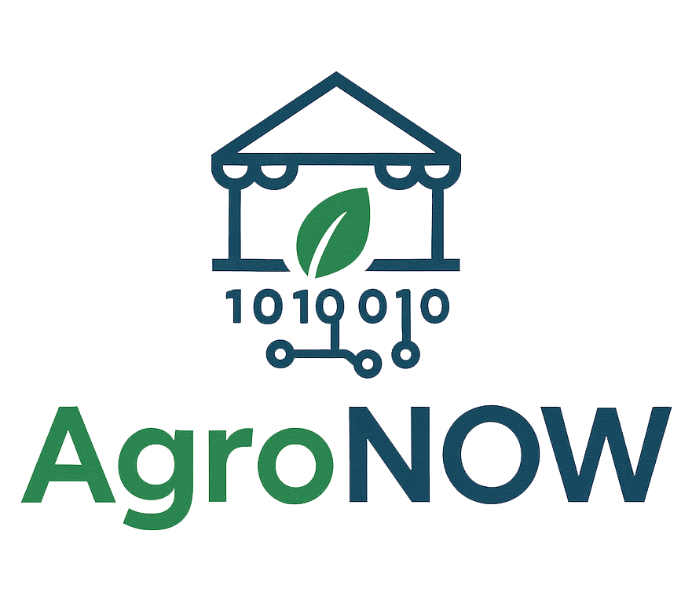

# Proiect Diploma Licență NIȚU Robert-Ionuț, FIIR IAII 2021-2025

### PROIECTAREA UNUI ALGORITM ȘI DEZVOLTAREA UNEI APLICAȚII INFORMATICE PENTRU DIGITALIZAREA UNOR ACTIVITĂȚI DIN PIEȚELE AGROALIMENTARE

